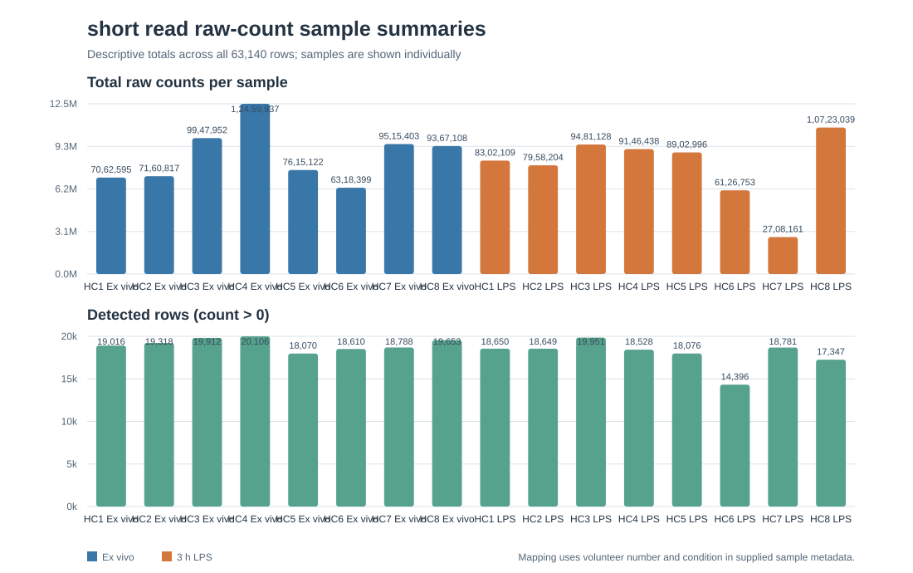
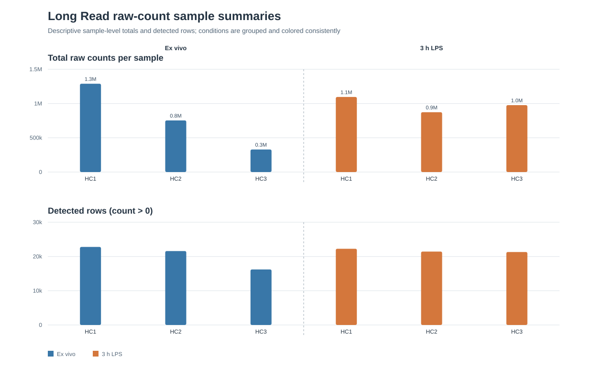

# Task 3 — Visualization and interpretation

## Scope and inputs

This task makes descriptive plots from the Task 2 cleaned **raw-count** matrices and the existing sample metadata. It uses `data/cleaned/short_read_raw_counts.txt`, `data/cleaned/long_read_raw_counts.txt`, and `metadata/sample_metadata.tsv`. The Task 2 report (`results/task2_data_summary.json`) provides the validation context. The processed Salmon abundance matrices are not combined with raw counts or used in these figures because they are a different measure.

The script maps each count column to the metadata using its HC volunteer number and condition label. For long-read raw counts, each matrix row is counted once using the row-level `ids` structure already documented in Task 2; repeated `gene_id` annotations are not treated as duplicate rows.

## Reproduction

From this repository root, run:

```bash
python scripts/visualize_task3.py
```

The script uses only the Python standard library (Python 3.9 or newer). It writes three SVG figures to `results/figures/` and per-sample numeric values to `results/task3_sample_metrics.tsv`. No statistical testing or cross-platform merging is performed.

## Figures and interpretation

### Short-read raw-count sample summaries



The upper panel shows the sum of the supplied raw gene counts for each of the 16 short-read samples. The lower panel counts rows with a raw count greater than zero. Both panels use the same condition colors and group samples by condition. Donors are labeled within each condition.

Across the eight ex vivo samples, total counts range from 6,318,399 to 12,459,937 and detected rows range from 18,070 to 20,106. Across the eight LPS samples, total counts range from 2,708,161 to 10,723,039 and detected rows range from 14,396 to 19,951. These are descriptive ranges from the checked-in table.

**What it does not prove:** These library totals and detected-row counts are not normalized expression measurements. By themselves they do not show differential expression, statistical significance, treatment effects, gene identity or function, or biological cause. Differences may reflect library depth and other technical or sample-level variation.

### Native long-read raw-count sample summaries



The panels show total raw counts and rows with a raw count greater than zero for the six native long-read samples (three per condition). Samples are grouped by condition and donor. Each row corresponds to the row-level feature in the source matrix; the repeated `gene_id` annotations are preserved and are not collapsed.

Across the three ex vivo samples, total counts range from 329,056 to 1,289,290 and detected rows range from 16,211 to 22,790. Across the three LPS samples, total counts range from 873,440 to 1,096,147 and detected rows range from 21,302 to 22,257. These small group sizes and descriptive summaries support only a view of the supplied samples.

**What it does not prove:** The plot does not establish differential transcript abundance, isoform switching, statistical significance, reproducibility in a population, or a causal LPS response. It does not adjust for sequencing depth or other covariates. A nonzero row is not evidence of a reliably detected or biologically relevant transcript.

### Short-read top-100 gene-count share by donor


For each short-read sample, the 100 rows with the largest raw gene counts were selected **within that sample**. The chart shows their summed counts as a percentage of that sample's total gene counts, pairing the two conditions for each of the eight donors. This is a concentration summary; the top-100 set can contain different genes in different samples.

In the checked-in table, the top-100 share is 24.9–32.0% in ex vivo samples and 42.6–50.8% in LPS samples. All eight donor pairs have a higher share in LPS; paired differences range from 15.1 to 18.9 percentage points. This is a descriptive pattern in these samples. It indicates that the raw-count composition is more concentrated in the largest-count rows in LPS samples, so total-count depth scaling alone may be sensitive to composition differences. This should be examined when choosing normalization and modeling methods in a later analysis.

**What it does not prove:** The chart does not identify which genes drive the pattern because the top 100 are selected separately for each sample. It does not establish differential expression, a biological mechanism, statistical significance, or that LPS caused the change. A higher fraction could reflect increased abundance of some genes, decreased abundance of others, or both; raw counts alone cannot distinguish these explanations.

## Limitations

- The sample-summary figures show raw counts without normalization or transformation; total counts are strongly affected by sequencing depth. The top-100 fraction is a within-sample proportion and describes composition, not normalized gene-level expression.
- The short-read top-100 comparison uses eight donor pairs, but the figure is descriptive and has no inferential test. Its top-100 gene membership is sample-specific.
- The short-read and long-read assays differ in platform, sample size, and table feature structure. Their counts are shown separately and must not be compared on the same numeric scale.
- The short-read samples have eight volunteers per condition; the native long-read samples have three per condition. The figure is descriptive and does not resolve pairing or other study-design questions.
- The detected-row threshold is exactly `count > 0`, selected as a transparent descriptive summary, not as a validated expression threshold.
- These charts summarize the processed tables supplied in this repository. They do not independently verify upstream quantification, sample identity, or biological validity.

## Deliverables

- Reproducible script: `scripts/visualize_task3.py`
- Figures: `results/figures/short_read_sample_summary.svg`, `results/figures/long_read_sample_summary.svg`, and `results/figures/short_read_top100_gene_share.svg`
- Per-sample values: `results/task3_sample_metrics.tsv`
