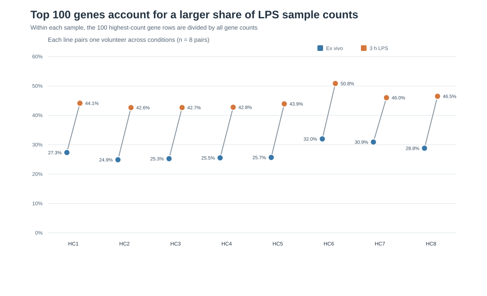
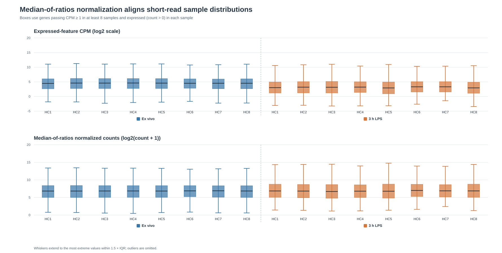
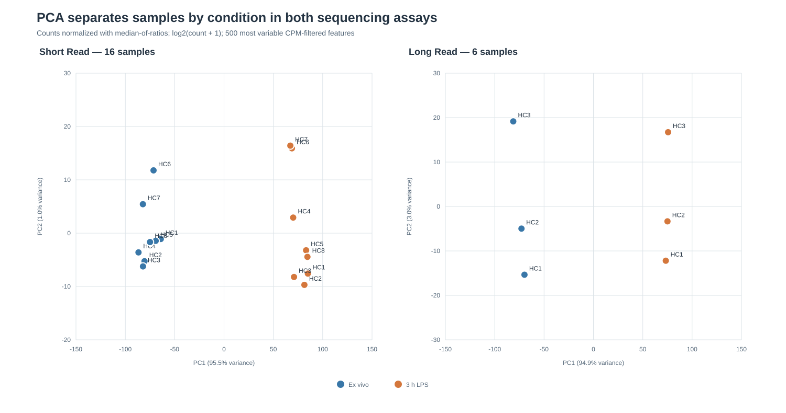
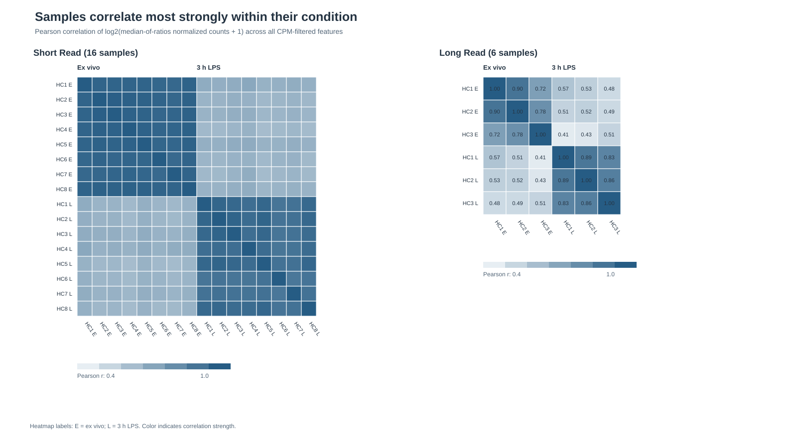

# Task 3 — Visualization and interpretation

## Scope and inputs

The figures use the checked-in Task 2 cleaned raw-count tables and `metadata/sample_metadata.tsv`. Short-read and native long-read data are processed and plotted separately. These are descriptive analyses; no differential-expression test or p-value is calculated.

## Reproduction and methods

From the repository root, run:

```bash
python scripts/visualize_task3.py
```

The script uses Python 3.9+ and the standard library only. It writes four SVG figures and `results/task3_sample_metrics.tsv`.

- **Feature filter:** calculate counts per million (CPM) from each table's raw library totals; retain features with CPM ≥ 1 in at least the smallest condition group (8 samples for short-read; 3 for long-read). This gives 12,428 short-read genes and 23,386 long-read transcript rows.
- **Size factors:** use the median-of-ratios estimator (`ratio` method): compute each all-positive feature's geometric mean across samples, take the median count-to-geometric-mean ratio per sample, and scale factors to geometric mean 1. Features with a zero in any sample are omitted from the geometric-mean step, as in the default ratio method.
- **Log values:** use log2(normalized count + 1), where normalized count is raw count divided by its size factor.
- **PCA:** use the 500 filtered features with highest across-sample variance in log2 normalized counts. Center each feature across samples and project samples onto the first two principal components.
- **Correlation:** calculate Pearson correlation between samples across all filtered log2 normalized features (not just the 500 PCA features).

## Figures and interpretation

### 1. Short-read top-100 gene-count share



For each sample, the 100 rows with the highest raw gene counts are selected within that sample; their counts are shown as a fraction of all counts. The top-100 set can differ from sample to sample.

The share is 24.9–32.0% ex vivo and 42.6–50.8% after LPS. It is higher in all eight donor pairs, by 15.1–18.9 percentage points. This shows greater concentration of the observed counts among the highest-count rows in the LPS samples.

**It does not prove:** which specific genes drive the pattern, differential expression, a causal LPS effect, or statistical significance. A change in share can result from changes in the top genes, the remaining genes, or both. It does flag that composition differences may affect simple library-depth scaling.

### 2. Short-read CPM and median-of-ratios distributions



Each box summarizes genes that pass the CPM filter and have a nonzero count in that sample. The first panel shows log2 CPM; the second shows log2(size-factor-normalized count + 1). CPM medians are 22.2–24.4 ex vivo and 7.6–10.0 after LPS. After median-of-ratios normalization, per-sample medians fall between 6.70 and 7.00 on the log2 scale.

This illustrates that median-of-ratios size factors align the central sample distributions despite the CPM median shift.

**It does not prove:** that the normalization is biologically correct, that most genes are unchanged, or that individual genes have no treatment response. Median alignment is a distribution check, not validation against an external truth. Outliers are not drawn; whiskers extend to the most extreme values within 1.5 × IQR.

### 3. PCA of normalized log counts



PC1 explains 95.45% of variance for short-read and 94.86% for long-read among the selected 500 features. In both panels, samples separate by condition along PC1.

This shows that condition labels align with the largest axis of variation in these processed data after the stated filter and normalization. The same qualitative separation appears in both sequencing technologies, which remain analyzed independently.

**It does not prove:** that LPS caused all of the separation, which genes drive it, statistical significance, or generalization beyond these donors. PCA is descriptive, and the result depends on the filter, normalization, log transform, and variable-feature selection.

### 4. Sample-to-sample correlation heatmaps



Pearson correlations use all CPM-filtered normalized log-count features. In both technologies, within-condition samples are more similar to one another than to samples in the other condition. For native long-read ex vivo samples, HC3 correlates 0.725 with HC1 and 0.785 with HC2; HC1 and HC2 correlate 0.901 with each other. HC3 also has the smallest long-read raw-count total (329,056).

The weaker HC3 correlations and its shallower library are observations to keep in mind during later analysis.

**It does not prove:** that low sequencing depth caused the lower correlations, that HC3 is an outlier to remove, or that any pairwise correlation is statistically significant. Long-read groups have only three samples each.

## Limitations

- These figures summarize processed counts and are not differential-expression or isoform-switching tests.
- Median-of-ratios normalization relies on a compositional assumption about the bulk of features; the top-100 pattern makes that assumption important to revisit in a later inferential analysis.
- The CPM filter is a descriptive feature filter and is not a substitute for a statistical model's filtering procedure.
- PCA and correlations depend on the stated normalization, filter, log transform, and feature set. PC1 variance is not a measure of treatment effect size or significance.
- Short-read has eight donors per condition; long-read has three. Conclusions, especially from long-read, are descriptive and have limited population-level support.
- The analysis does not independently validate upstream quantification, sample identity, or biological validity.

## Deliverables

- Reproducible script: `scripts/visualize_task3.py`
- Figures: `results/figures/short_read_top100_gene_share.svg`, `results/figures/short_read_normalization_boxplots.svg`, `results/figures/normalized_counts_pca.svg`, and `results/figures/sample_correlation_heatmaps.svg`
- Per-sample metrics: `results/task3_sample_metrics.tsv`
